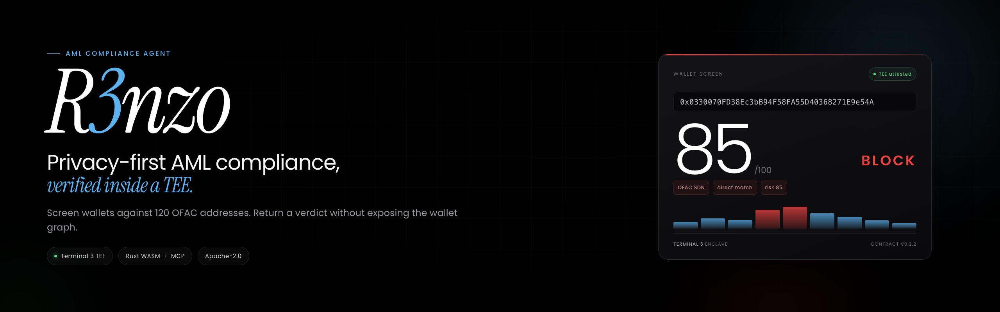
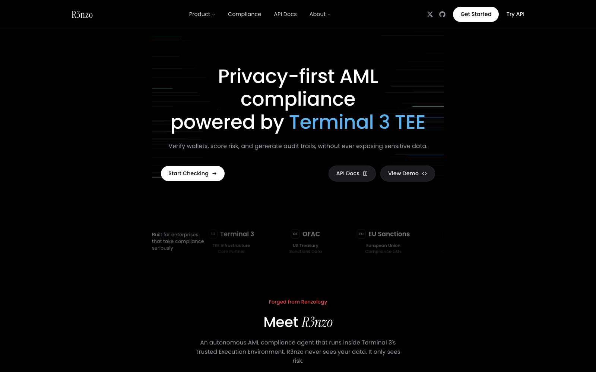
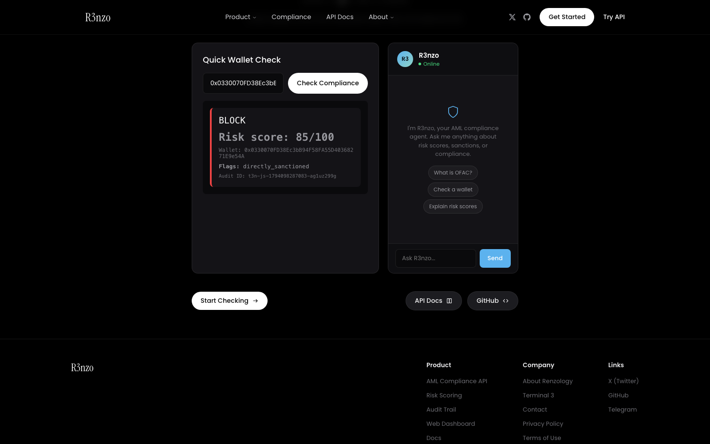
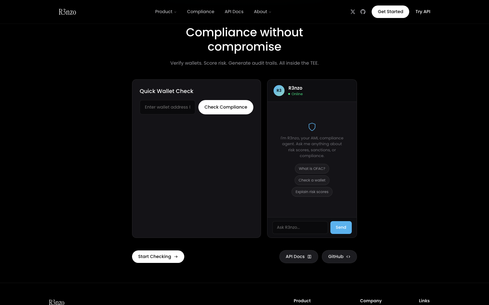
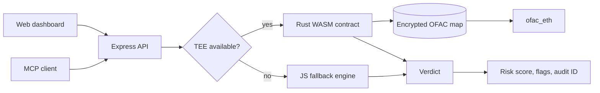

<p align="center">
  
</p>

<p align="center">
  <a href="https://github.com/maxxexee/aml-compliance-agent/actions/workflows/check.yml"></a>
  <a href="LICENSE"></a>
  <a href="https://docs.terminal3.io"></a>
  <a href="t3n-contract"></a>
  <a href="mcp-server"></a>
  <a href="data/ofac_eth.txt"></a>
</p>

R3nzo screens Ethereum wallets against 120 OFAC addresses and returns an explainable verdict. The sanctions list and risk model are designed to run inside a Terminal 3 Trusted Execution Environment, so the host only sees the result.

> **Testnet prototype.** The T3N account has zero credits, so the running API uses the JavaScript fallback. The v0.2.2 contract is built and ready to register, but v0.1.0 is still the registered version. The API is unauthenticated and is not ready for production or customer data.

## Contents

- [Why this exists](#why-this-exists)
- [What it does](#what-it-does)
- [Live demo](#live-demo)
- [Screens](#screens)
- [How it works](#how-it-works)
- [Architecture](#architecture)
- [TEE contract](#tee-contract)
- [Verification](#verification)
- [Deployed and registered](#deployed-and-registered)
- [Tech stack](#tech-stack)
- [Repository layout](#repository-layout)
- [Quickstart](#quickstart)
- [Environment variables](#environment-variables)
- [Scripts](#scripts)
- [API](#api)
- [MCP server](#mcp-server)
- [Known gaps](#known-gaps)
- [Roadmap](#roadmap)
- [Security](#security)
- [Contributing](#contributing)
- [License](#license)

## Why this exists

Compliance teams need to answer a simple question: is this wallet safe to transact with? The hard part is doing it without shipping customer data or the sanctions model to every service that asks.

R3nzo keeps the check inside an enclave and returns only the verdict. The public address goes in. A status, risk score, flags, and audit ID come out.

## What it does

- Screens one wallet or a batch of up to 50.
- Matches against 120 OFAC sanctioned Ethereum addresses.
- Scores risk with four weighted factors: sanctions, mixers, jurisdiction, and transaction patterns.
- Returns APPROVE, REVIEW, or BLOCK with flags and an audit ID.
- Serves a dashboard with a quick wallet check and a compliance chat.
- Exposes the same compliance engine as an MCP server for Claude, Cursor, and other AI clients.

## Live demo

The previous Render deployment is offline. Deploy a new service from the included blueprint:

[Deploy to Render](https://render.com/deploy?repo=https://github.com/maxxexee/aml-compliance-agent)

Set `T3N_API_KEY` and `OPENROUTER_API_KEY` when prompted. The app starts with the JavaScript fallback until T3N credits are available. For a local run, see [Quickstart](#quickstart).

## Screens

<p align="center">
  
</p>

| Wallet check | Compliance chat |
| --- | --- |
|  |  |

The dashboard is served by the API at `/`. The screenshots above were captured from the local app on port 3011.

## How it works

1. The dashboard or an API client sends a public wallet address.
2. The API validates the address and asks the TEE contract to run the check.
3. The contract reads `ofac_eth` from the encrypted `z:<tenant>:ofac` map.
4. Risk scoring applies the configured weights and thresholds inside the enclave.
5. The API returns the status, score, flags, and audit ID.
6. If the TEE call fails, the API falls back to `t3n-contracts/compliance.js` and marks the audit ID with the `t3n-js-` prefix.

## Architecture



The API is the only public surface. The TEE contract and the KV map are not exposed directly. The MCP server is a separate package that exposes the same compliance tools to AI clients.

## TEE contract

| Item | Value |
| --- | --- |
| Source | `t3n-contract/src/lib.rs` and `t3n-contract/src/compliance.rs` |
| Version | 0.2.2 |
| Target | `wasm32-wasip2` |
| Build size | 186306 bytes, about 182KB |
| Registered version | 0.1.0, contract ID 786 |
| Sanctions map | `z:<tenant>:ofac`, key `ofac_eth` |
| Current state | Built; registration blocked by zero T3N credits |

Build the contract:

```bash
rustup target add wasm32-wasip2
cargo build --manifest-path t3n-contract/Cargo.toml --target wasm32-wasip2 --release
```

Register v0.2.2 after the account has credits:

```bash
node t3n-contract/register-v2.mjs
```

Seed the `ofac` map with the 120 addresses:

```bash
node t3n-contract/final-seed.mjs
```

The v0.1.0 contract reads from `z:<tenant>:sanctions`. The v0.2.2 source reads `ofac_eth` from `z:<tenant>:ofac` and falls back to chunked keys. The registration attempt currently returns:

```text
InsufficientCredit (account=51792674f39e3f1958ddc7c7c52f51860fa60fa0, required=10000000000, available=0)
```

See [t3n-contract/README.md](t3n-contract/README.md) for the canonical scripts and the historical one-offs.

## Verification

| Check | Surface | Result |
| --- | --- | --- |
| Sanctions data | `wc -l data/ofac_eth.txt` | 120 addresses |
| Unit tests | `npm test` | Sanctions loader and matching |
| Repository checks | `npm run check` | Required files, links, metadata, JS syntax |
| Contract build | `cargo build --target wasm32-wasip2 --release` | 186306 bytes |
| Sanctioned wallet | `POST /api/check-wallet` | BLOCK, score 85, `directly_sanctioned` |
| Clean wallet | `POST /api/check-wallet` | APPROVE, score 0 |
| TEE registration | `node t3n-contract/register-v2.mjs` | Blocked, available credits 0 |
| Live app | Render | Offline, needs a new service |

Run the local check:

```bash
curl -s -X POST http://localhost:3001/api/check-wallet \
  -H 'Content-Type: application/json' \
  -d '{"wallet":"0x0330070FD38Ec3bB94F58FA55D40368271E9e54A"}'
```

```json
{
  "status": "BLOCK",
  "wallet": "0x0330070FD38Ec3bB94F58FA55D40368271E9e54A",
  "risk_score": 85,
  "flags": ["directly_sanctioned"],
  "audit_id": "t3n-js-...",
  "jurisdiction": "GLOBAL"
}
```

A clean address such as `0x1111111111111111111111111111111111111111` returns APPROVE with score 0.

## Deployed and registered

| Item | Value |
| --- | --- |
| T3N tenant DID | `did:t3n:51792674f39e3f1958ddc7c7c52f51860fa60fa0` |
| Registered contract | `786`, version 0.1.0 |
| Target contract name | `z:51792674f39e3f1958ddc7c7c52f51860fa60fa0:aml-compliance`, version 0.2.2, not registered |
| Sanctions map | `z:51792674f39e3f1958ddc7c7c52f51860fa60fa0:ofac`, key `ofac_eth` |
| Render | Blueprint in `render.yaml`; previous service offline |

## Tech stack

| Layer | Technology |
| --- | --- |
| TEE | Terminal 3 T3N SDK 5.2 |
| Contract | Rust, `wasm32-wasip2`, WIT bindings |
| API | Node.js, Express 4 |
| Dashboard | Vanilla JavaScript, Poppins and Instrument Serif |
| MCP | TypeScript, MCP SDK, Zod |
| On-chain data | Ethers 6, public Ethereum RPC |
| Chat | OpenRouter, Nemotron 120B |
| Data | 120 OFAC Ethereum addresses and the SDN source file |

## Repository layout

```text
.
├── api/                  Express API, T3N client, on-chain data
├── data/                 120 OFAC addresses and SDN source
├── docs/
│   ├── assets/           Banner, social preview, screenshots
│   └── brand.html        Source artboards for the image assets
├── mcp-server/           MCP server with 5 tools
├── scripts/              Repository checks
├── t3n-contract/         Rust WASM contract and T3N scripts
├── t3n-contracts/        JavaScript fallback compliance engine
├── test/                 Unit tests
├── web/pages/            Dashboard
├── .github/              Issue forms, PR template, CI, Dependabot
├── config.json           Risk weights and thresholds
├── render.yaml           Render blueprint
├── test.js               Endpoint integration checks
└── package.json
```

`t3n-reference/` is a local reference checkout and is not part of the repository.

## Quickstart

Requirements: Node.js 20 or newer, npm, and optionally Rust with the `wasm32-wasip2` target.

```bash
git clone https://github.com/maxxexee/aml-compliance-agent.git
cd aml-compliance-agent
npm ci
cp .env.example .env
# Set T3N_API_KEY and OPENROUTER_API_KEY in .env
npm start
```

Open `http://localhost:3001`. The API is served under `/api` and the dashboard is served at `/`.

The server starts with the JavaScript fallback when T3N credits are unavailable. Chat requires an OpenRouter key.

## Environment variables

| Variable | Required | Description |
| --- | --- | --- |
| `T3N_API_KEY` | For the TEE path | Terminal 3 API key used for the T3N handshake and contract calls |
| `OPENROUTER_API_KEY` | For chat | OpenRouter key used by `/api/chat` |
| `PORT` | No | API and dashboard port, default `3001` |

## Scripts

| Command | Description |
| --- | --- |
| `npm start` | Start the API and dashboard |
| `npm run dev` | Start with file watching |
| `npm test` | Run the unit tests |
| `npm run test:integration` | Run endpoint checks against `http://localhost:3001`; set `API_URL` for another port |
| `npm run check` | Run repository and link checks |

The root package has no build step. Build the MCP server separately:

```bash
cd mcp-server
npm ci
npm run build
```

## API

| Endpoint | Method | Description |
| --- | --- | --- |
| `/api/health` | GET | Service status and T3N connection |
| `/api/check-wallet` | POST | Check one wallet |
| `/api/check-batch` | POST | Check up to 50 wallets |
| `/api/sanctions` | GET | Sanctions list summary |
| `/api/audit` | GET | Recent audit entries |
| `/api/chat` | POST | Compliance chat |
| `/api/agent/health` | GET | Chat provider health |

Check a wallet:

```bash
curl -s -X POST http://localhost:3001/api/check-wallet \
  -H 'Content-Type: application/json' \
  -d '{"wallet":"0x0330070FD38Ec3bB94F58FA55D40368271E9e54A"}'
```

Check a batch:

```bash
curl -s -X POST http://localhost:3001/api/check-batch \
  -H 'Content-Type: application/json' \
  -d '{"wallets":["0x1111111111111111111111111111111111111111","0x0330070FD38Ec3bB94F58FA55D40368271E9e54A"]}'
```

The API has no authentication or rate limiting. Treat it as a local demo.

## MCP server

The MCP server exposes five tools:

| Tool | Description |
| --- | --- |
| `check_wallet` | Check one wallet for AML risk |
| `check_batch` | Check multiple wallets at once |
| `explain_risk` | Explain a risk score and its factors |
| `get_sanctions` | List the sanctions data the engine checks |
| `get_t3n_status` | Check the TEE connection status |

Build and connect:

```bash
cd mcp-server
npm ci
npm run build
```

Example Claude Desktop configuration:

```json
{
  "mcpServers": {
    "r3nzo-compliance": {
      "command": "node",
      "args": ["/absolute/path/to/aml-compliance-agent/mcp-server/build/index.js"],
      "env": {
        "T3N_API_KEY": "your-t3n-api-key"
      }
    }
  }
}
```

The MCP package has its own README at [mcp-server/README.md](mcp-server/README.md).

## Known gaps

- The T3N account has zero credits. The API uses the JavaScript fallback for every check.
- The registered contract is v0.1.0 and reads the old `sanctions` map. The v0.2.2 source is built but not registered.
- The API has no authentication, rate limiting, or durable audit storage.
- The Render service is offline and needs to be recreated from `render.yaml`.
- The dashboard chat depends on OpenRouter and fails without a key or available quota.
- The JavaScript fallback is not a substitute for the TEE path. It exists so the product can be demonstrated and tested.
- The TEE contract is built in CI but has no contract-level unit tests.
- The risk score is an explainable heuristic, not a regulatory certification.

## Roadmap

- Claim T3N test credits and register v0.2.2.
- Seed `z:<tenant>:ofac` with `ofac_eth` and verify the TEE path end to end.
- Add API authentication, rate limiting, and a persistent audit store.
- Add contract tests for sanctions matching and each threshold boundary.
- Recreate the Render service and publish a live demo.
- Publish the MCP package and add more resources.

## Security

This is a testnet prototype. Do not submit real customer data, private keys, or production sanctions decisions.

The API is unauthenticated. The audit log is in memory. The TEE path depends on Terminal 3 testnet availability and credits.

Report vulnerabilities privately using the process in [SECURITY.md](SECURITY.md). Do not open a public issue for a security problem.

## Contributing

Read [CONTRIBUTING.md](CONTRIBUTING.md) before opening a pull request. Run:

```bash
npm ci
npm test
npm run check
```

For contract changes, also build the WASM target:

```bash
cargo build --manifest-path t3n-contract/Cargo.toml --target wasm32-wasip2 --release
```

Keep the README and docs free of emojis and em dashes.

## License

Apache License 2.0. See [LICENSE](LICENSE) and [NOTICE](NOTICE).
